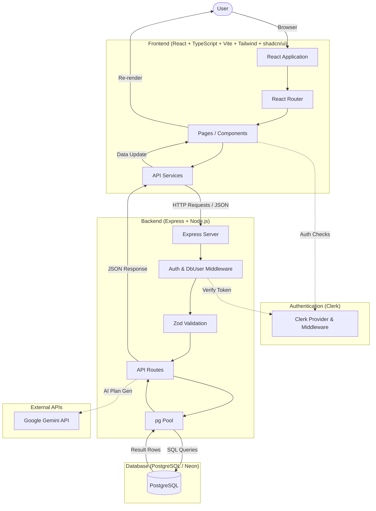

# ClearTasks Architecture & Code-Flow Audit

This document provides a complete architecture and code-flow audit of the **ClearTasks** project, based strictly on the current implementation.

---

## 1. PROJECT ARCHITECTURE

ClearTasks is a modern web application designed for project planning and task management, featuring AI-assisted project generation and role-based access.



- **Clerk Authentication**: Handles user registration, login, session management, and project invitations (via `publicMetadata`).
- **Gemini AI**: Generates and improves structured project plans (phases, tasks, milestones).
- **PostgreSQL / Neon**: The primary database storing users, projects, tasks, milestones, team profiles, and invitations.
- **Express Backend**: Serves as the API layer (`/api/*`), handling business logic, DB queries, validation (Zod), and AI coordination.
- **React Frontend**: A Single Page Application (SPA) providing the UI, managing state, and communicating with the backend via `fetch`.
- **TypeScript**: Used extensively across frontend and backend for strong typing.
- **Tailwind & shadcn/ui**: Used for frontend styling and component structure.

---

## 2. COMPLETE DIRECTORY MAP

### `frontend/`
Responsible for the user interface, routing, and client-side logic.
- `src/`
  - `App.tsx`: Main routing file defining all application routes.
  - `main.tsx`: Entry point mounting the React app and Clerk Provider.
  - `index.css` & `App.css`: Global Tailwind CSS imports and basic styling.
  - `pages/`: Contains all route components.
    - `auth/`: Login and Signup pages utilizing Clerk UI components.
    - `projects/`: 
      - `AllProjects.tsx`: Dashboard showing list of projects.
      - `ProjectDashboard.tsx`: Individual project overview (metrics, progress).
      - `create/`: Contains `CreateProjectFlow.tsx` (the multi-step AI wizard) and its individual steps (`ProjectInfoForm`, `TeamProfilesForm`, etc.).
    - `tasks/`: `TaskBoard.tsx` and `TaskDetailsPage.tsx`.
    - `milestones/`: `Milestones.tsx`.
    - `team/`: `Team.tsx` (managing members and profiles).
    - `notifications/`: `Notifications.tsx`.
    - `settings/`: `Settings.tsx`.
    - `InviteAccept.tsx`: Handles accepting project invitations from email links.
    - `LandingPage.tsx`: The public facing marketing page.
  - `components/`: Shared UI components (mostly shadcn/ui primitives like Buttons, Cards, Inputs).
  - `services/`: 
    - `api.ts`: Centralized `fetch` wrappers for all backend communication (`projectService`, `taskService`, `aiService`, etc.).
  - `layouts/`: `DashboardLayout.tsx` (Sidebar, Topbar for authenticated views).
  - `types/`: Shared TypeScript interfaces.

### `server/`
Responsible for the API endpoints, database interactions, and business logic.
- `src/`
  - `app.ts`: Express application setup, global middleware (CORS, body-parser), Clerk middleware, and route mounting.
  - `server.ts`: Entry point starting the Express listener.
  - `routes/`: 
    - `projects.ts`: CRUD for projects, members, team profiles, tasks, milestones.
    - `ai.ts`: Communicates with Gemini API to generate/improve project plans.
    - `invitations.ts`: Creates and accepts project invitations, maps Clerk users to DB profiles.
    - `tasks.ts`, `milestones.ts`, `users.ts`, `notifications.ts`: Resource-specific endpoints.
  - `db/`
    - `index.ts`: PostgreSQL `pg` Pool connection setup.
  - `middleware/`
    - `auth.ts`: `attachDbUser` middleware which extracts the Clerk user ID, looks up/creates the corresponding PostgreSQL user, and attaches `req.dbUser`.
  - `utils/`
    - `validators.ts`: Zod schemas for request payload validation.
- `migrations/`: Contains raw SQL files (`.sql`) for setting up and altering the PostgreSQL schema (e.g., `1791191023682_initial-schema.sql`).

---

## 3. USER ACTION → FILE FLOW

### USER ACTION: User creates a project

1. **UI**: 
   - File: `frontend/src/pages/projects/create/CreateProjectFlow.tsx`
   - Component: `CreateProjectFlow` (Wizard orchestrator)
   - Responsibility: Collects project details, team profiles, calls AI for plan, reviews plan, submits final project.
2. **State**: 
   - File: `CreateProjectFlow.tsx`
   - State variable: `projectData` (stores form inputs), `aiPlan` (stores Gemini response).
   - What changes: User proceeds through states (`INFO` -> `TEAM_PROFILES` -> `ANALYZING` -> `INITIAL_PLAN` -> `REVIEW`).
3. **API**: 
   - File: `frontend/src/services/api.ts`
   - Function: `projectService.createProject`
   - HTTP method: `POST`
   - Endpoint: `/api/projects`
4. **Backend**: 
   - File: `server/src/routes/projects.ts`
   - Route: `router.post('/')`
   - Middleware: `clerkMiddleware`, `requireAuth`, `attachDbUser` (ensures user exists in DB).
   - Validation: `projectSchema.safeParse(req.body)` validates incoming project/task/milestone structure.
5. **Database**: 
   - File: `server/src/routes/projects.ts` (using `server/src/db/index.ts`)
   - Query: `BEGIN`, `INSERT INTO projects`, `INSERT INTO project_members` (as OWNER), `INSERT INTO project_team_profiles`, `INSERT INTO milestones`, `INSERT INTO tasks`, `COMMIT`.
   - Tables affected: `projects`, `project_members`, `project_team_profiles`, `milestones`, `tasks`.
6. **Response**: 
   - Backend returns: `{ success: true, data: project }` (contains new project ID).
7. **Frontend**: 
   - File: `CreateProjectFlow.tsx`
   - How response is stored: `setCreatedProjectId(project.id)`
   - What component re-renders: `CreateProjectFlow` switches state to `SUCCESS`, rendering `ProjectSuccess`.
8. **Final UI**: 
   - User sees a success screen with a button to view the newly created Project Dashboard.

---

## 4. AUTHENTICATION FLOW

- **A. User signs up / B. User logs in**: Handled entirely by Clerk components (`<SignUp />`, `<SignIn />`) on the frontend. Clerk manages the session token.
- **C. User logs out**: Handled by Clerk's `<SignOutButton />` or `useClerk().signOut()`.
- **D. User refreshes the browser**: Clerk automatically restores the session using secure cookies/tokens.
- **E. User accesses a protected page**: React Router prevents access if not authenticated; `DashboardLayout` checks Clerk's `useAuth()`.
- **F. Frontend calls a protected backend API**: `frontend/src/services/api.ts` retrieves the token via `(window as any).Clerk.session.getToken()` and attaches it to the `Authorization: Bearer <token>` header.
- **G. Backend identifies the current user**: `server/src/app.ts` uses `@clerk/express` `requireAuth()` middleware to parse the token.
- **H. Clerk user is mapped to PostgreSQL users table**: 
  - `server/src/middleware/auth.ts` (`attachDbUser`). 
  - It extracts `req.auth.userId` (Clerk ID). 
  - Queries `SELECT * FROM users WHERE clerk_user_id = $1`. 
  - If not found, it fetches details via `clerkClient.users.getUser()`, runs an `INSERT INTO users`, and attaches the resulting row to `req.dbUser`.

---

## 5. CREATE PROJECT FLOW

State machine in `frontend/src/pages/projects/create/CreateProjectFlow.tsx`:
- **`INFO`**: Renders `ProjectInfoForm`. User enters title, description, deadline, team size.
- **`TEAM_PROFILES`**: Renders `TeamProfilesForm`. User enters display names, skills for team members.
- **`ANALYZING`**: Renders `AIAnalysisLoading`. Frontend calls `aiService.analyzeProject`.
- **`INITIAL_PLAN`**: Renders `InitialPlanReview`. Shows the AI-generated tasks and milestones. User can "Proceed" or "Improve".
- **`IMPROVING`**: Renders `ImprovePlanForm`. User specifies requested changes. Calls `aiService.improvePlan`.
- **`IMPROVED_PLAN`**: Renders `InitialPlanReview` again with the new plan.
- **`REVIEW`**: Renders `ReviewConfirm`. Final check before database insertion. Calls `projectService.createProject`.
- **`SUCCESS`**: Renders `ProjectSuccess`.

Data passed step-to-step is aggregated in the `projectData` and `aiPlan` React state objects. Temporary milestone IDs (`m1`, `m2`) and relative days are calculated by Gemini and maintained in frontend state until the final POST, where the backend converts them to UUIDs and explicit dates.

---

## 6. GEMINI AI FLOW

1. **Frontend Request**: `aiService.analyzeProject(payload)` in `api.ts`.
2. **Backend Route**: `POST /api/ai/analyze` in `server/src/routes/ai.ts`.
3. **Prompt Construction**: Merges user constraints (deadline, team size, profiles) with a strict system prompt demanding a JSON response conforming to a specific schema.
4. **Gemini Execution**: Uses `@google/genai`. Calls `generateWithFallback` attempting `gemini-3.1-flash-lite`, then `gemini-3.5-flash-lite`, etc.
5. **Validation & Timeline Scaling**: 
   - AI returns JSON.
   - Backend parses and validates the schema.
   - **Crucial step**: Backend calculates `availableDays` between today and the deadline. If the AI proposed a `timelineDays` exceeding this, it proportionally scales all `relativeStartDay`, `relativeDueDay`, and milestone `relativeDay` values to fit perfectly within the deadline constraint.
6. **Return**: The validated, scaled plan is returned to the frontend.
7. **Persistence**: The plan remains in memory on the frontend until the final step, where it is mapped into standard `projectService.createProject` payload.

---

## 7. TEAM / INVITATION FLOW

1. **Create Profiles**: During project creation, users define "Planned Profiles" (`project_team_profiles` table).
2. **Invite Member**: Owner goes to Team page, clicks invite. Frontend calls `POST /api/invitations`.
3. **Clerk Invitation**: `server/src/routes/invitations.ts` verifies owner role, checks for existing invites, then calls `clerkClient.invitations.createInvitation()`. It attaches `projectId` and `teamProfileId` to Clerk's `publicMetadata`.
4. **Database Record**: Inserts into `project_invitations` table using the Clerk Invitation ID as the token.
5. **Accept Invitation**: Invited user clicks the email link, lands on `/accept-invitation` (`InviteAccept.tsx`). User signs up/logs in via Clerk.
6. **Link Profile & Remap Tasks**: 
   - Frontend calls `POST /api/invitations/accept` (`invitations.ts`).
   - Backend reads `publicMetadata` from the newly signed-in Clerk user.
   - Finds the pending invitation in `project_invitations`.
   - `UPDATE project_team_profiles SET linked_user_id = $1`.
   - `UPDATE tasks SET assigned_to = $1 WHERE assigned_profile_id = $2`. (Tasks assigned to the placeholder profile are now assigned to the real user).
   - `INSERT INTO project_members`.
   - `UPDATE project_invitations SET accepted_at = CURRENT_TIMESTAMP`.

---

## 8. TASK FLOW

1. **AI creates task**: AI outputs a task object.
2. **Stored in DB**: `POST /api/projects` route iterates over `req.body.tasks`, calculates exact `due_date` based on relative days, and executes `INSERT INTO tasks`. Links `milestone_id` and `assigned_profile_id`.
3. **Appears in Task Board**: `TaskBoard.tsx` calls `GET /api/projects/:id/tasks` which joins `tasks`, `users`, `project_team_profiles`, and `milestones`.
4. **Status Change**: User drags a task in Kanban board.
5. **API Update**: `TaskBoard.tsx` updates local state, then calls `taskService.updateTaskStatus(taskId, status)`.
6. **Backend**: `PUT /api/tasks/:taskId` updates the DB.
7. **Global Sync**: (Currently, there is no WebSocket/real-time sync for tasks. The TaskBoard relies on standard React state updates and manual/interval refreshes).

---

## 9. MILESTONE FLOW

- **Creation**: Generated by AI or manually added. Stored in `milestones` table with a specific `due_date`.
- **Connection**: `tasks` table has a `milestone_id` foreign key.
- **Progress Calculation**: Handled dynamically on the frontend and backend reads. In `ProjectDashboard.tsx`, it filters tasks by `milestone.id`, counts `DONE` tasks, and divides by total tasks for that milestone to get a percentage.
- **Nesting**: When fetching milestones (`GET /api/projects/:id/milestones`), the backend uses a `LEFT JOIN tasks` and `json_agg` to embed an array of tasks within each milestone object for easy frontend rendering.

---

## 10. PROJECT DASHBOARD FLOW

1. **Component**: `frontend/src/pages/projects/ProjectDashboard.tsx`
2. **Data Fetching**: Triggers 4 parallel API calls: `getProject`, `getTasks`, `getMilestones`, `getTeamProfiles`.
3. **Frontend Calculations** (using `useMemo`):
   - **Overall Completion**: `tasks.filter(t => t.status === 'DONE').length / tasks.length * 100`
   - **Task Counts**: Filtered by status (`TODO`, `IN_PROGRESS`, `DONE`).
   - **Overdue**: Tasks where `status !== 'DONE'` and `due_date < now`.
   - **Project Health**: 'ON_TRACK', 'AT_RISK' (>20% overdue tasks), or 'OVERDUE'.
   - **Milestone Progress**: Calculated by grouping tasks by milestone ID.
   - **Team Workload**: Groups tasks by `assigned_profile_id` or `assigned_to` and calculates completion % per team member.

Calculations are intentionally placed on the frontend for immediate reactivity without heavy backend aggregation queries.

---

## 11. NAVIGATION FLOW

| User-facing page | URL/route | React component | Main responsibility |
|---|---|---|---|
| Landing | `/` | `LandingPage.tsx` | Marketing, sign in/up CTA |
| Login / Signup | `/login`, `/signup` | `Login.tsx`, `SignUp.tsx` | Authentication (Clerk) |
| Invite Acceptance | `/accept-invitation` | `InviteAccept.tsx` | Handles token acceptance flow |
| All Projects | `/dashboard` | `AllProjects.tsx` | List user's projects |
| Create Project | `/projects/new` | `CreateProjectFlow.tsx` | Multi-step AI project wizard |
| Project Dashboard | `/projects/:projectId` | `ProjectDashboard.tsx` | High-level project metrics |
| Tasks Board | `/projects/:projectId/tasks` | `TaskBoard.tsx` | Kanban board for tasks |
| Task Details | `/projects/:projectId/tasks/:taskId` | `TaskDetailsPage.tsx` | Deep dive into a specific task |
| Milestones | `/projects/:projectId/milestones` | `Milestones.tsx` | Timeline view of checkpoints |
| Team | `/projects/:projectId/team` | `Team.tsx` | View members, send invites |
| Notifications | `/notifications` | `Notifications.tsx` | View system alerts |
| Settings | `/settings` | `Settings.tsx` | User preferences |

---

## 12. DATABASE ARCHITECTURE

Current PostgreSQL schema:

- **`users`**: System users. Linked to Clerk via `clerk_user_id`. (No passwords).
- **`projects`**: Top-level project container. Contains `deadline`, `status`.
- **`project_members`**: Link table mapping `users` to `projects`. Holds `role` ('OWNER' or 'MEMBER').
- **`project_team_profiles`**: "Planned" team members. Represents a role/persona in a project. Has a `linked_user_id` when an actual user accepts an invitation.
- **`project_invitations`**: Tracks pending invites sent via email. References `team_profile_id` and holds the Clerk invite token.
- **`milestones`**: Key project checkpoints with a `due_date`.
- **`tasks`**: The work items. Links to `project_id`, optionally `milestone_id`, `assigned_to` (user ID), and `assigned_profile_id` (planned profile ID).
- **`task_dependencies`**: Many-to-many table allowing tasks to depend on other tasks (currently under-utilized).
- **`notifications`**: Alerts for users.

**Simplified ER Diagram:**
```text
users
  │ (1:N)
  ├── project_members ──────(N:1)────── projects
  │                                        │
  │ (1:N nullable)                         ├── (1:N) milestones
  ├── project_team_profiles ───(N:1)───────┤
  │       │                                ├── (1:N) project_invitations
  │       │ (1:N)                          │
  │ (1:N) └─────────────┐                  │
  └─────────────────── tasks ──(N:1)───────┘
                       │   │
     task_dependencies ┘   └ (N:1) milestones
```

---

## 13. API ARCHITECTURE

| METHOD | ENDPOINT | PURPOSE | AUTH | FILE | DB TABLES |
|---|---|---|---|---|---|
| GET | `/api/projects` | Get user's projects | Req | `projects.ts` | projects, project_members |
| GET | `/api/projects/:id` | Get specific project | Req | `projects.ts` | projects, project_members |
| POST | `/api/projects` | Create project + plan | Req | `projects.ts` | projects, members, team_profiles, milestones, tasks |
| PUT | `/api/projects/:id` | Update project details | Req | `projects.ts` | projects, project_members (auth) |
| GET | `/api/projects/:id/tasks`| Get project tasks | Req | `projects.ts` | tasks, users, team_profiles, milestones |
| GET | `/api/projects/:id/milestones`| Get project milestones | Req | `projects.ts` | milestones, tasks, users |
| POST | `/api/ai/analyze` | Generate AI plan | Req | `ai.ts` | (External API) |
| POST | `/api/ai/improve-plan` | Refine AI plan | Req | `ai.ts` | (External API) |
| POST | `/api/invitations` | Invite a member | Req | `invitations.ts` | project_invitations, project_members (auth) |
| POST | `/api/invitations/accept`| Accept an invite (ticket) | Req | `invitations.ts` | project_invitations, team_profiles, tasks, members |

*(Only major routes listed. See specific route files for task/milestone individual CRUD).*

---

## 14. DATA OWNERSHIP

| Data | Source of truth | Frontend representation | Backend representation |
|---|---|---|---|
| User Identity / Passwords | Clerk | Clerk Session / Context | `req.dbUser` (mirrored from Clerk) |
| Project Details | DB (`projects`) | `Project` object | `projects` table row |
| Team Members (Joined) | DB (`project_members`) | `ProjectMember` object | `project_members` + `users` |
| Planned Profiles | DB (`project_team_profiles`)| `TeamProfile` object | `project_team_profiles` table row |
| Task Status/Details | DB (`tasks`) | `Task` object | `tasks` table row |
| AI Plan (Draft) | Frontend State (`aiPlan`) | `AIProjectPlan` object | In-memory JSON during `/ai/*` |
| Milestone Dates | DB (`milestones`) | `Milestone` object | `milestones` table row |

---

## 15. "IF I CHANGE THIS, WHERE DO I GO?"

- **"If I change Task Board UI"** → `frontend/src/pages/tasks/TaskBoard.tsx`
- **"If I change task status behavior"** → `frontend/src/pages/tasks/TaskBoard.tsx` (drag logic) & `server/src/routes/tasks.ts` (if logic moves to standalone task route) or `projects.ts`.
- **"If I change task status API"** → `frontend/src/services/api.ts` (`updateTaskStatus`) & `server/src/routes/tasks.ts`.
- **"If I change AI prompt"** → `server/src/routes/ai.ts` (`systemPrompt` string inside `/analyze` or `/improve-plan`).
- **"If I change AI task assignment logic"** → `server/src/routes/ai.ts` (AI prompt instructions) AND `server/src/routes/projects.ts` (where `assignedToProfile` string is mapped to an actual `assigned_profile_id`).
- **"If I change project creation steps"** → `frontend/src/pages/projects/create/CreateProjectFlow.tsx` (state machine) and its step components in `frontend/src/pages/projects/create/steps/`.
- **"If I change invitation behavior"** → `frontend/src/pages/team/Team.tsx` (UI), `server/src/routes/invitations.ts` (Creation & Acceptance logic).
- **"If I change milestone progress calculation"** → `frontend/src/pages/projects/ProjectDashboard.tsx` (or `Milestones.tsx`). It is calculated on the client side.
- **"If I change dashboard metrics"** → `frontend/src/pages/projects/ProjectDashboard.tsx` (`useMemo` block).
- **"If I change authentication"** → `frontend/src/main.tsx` (Clerk Provider), `server/src/app.ts` (Clerk Middleware), `server/src/middleware/auth.ts` (`attachDbUser`).
- **"If I change database schema"** → Create a new file in `migrations/` and write pure SQL `ALTER TABLE` statements.
- **"If I change frontend styling"** → Component specific classes (Tailwind), `frontend/src/index.css`, or `frontend/tailwind.config.js`.

---

## 16. EVENT / STATE FLOW

### Example: CHANGE TASK STATUS
1. **User drags task**: In `TaskBoard.tsx`, `onDragEnd` fires.
2. **State update**: Optimistic UI update — React state `setTasks` moves the task to the new column immediately.
3. **API request**: `taskService.updateTaskStatus(taskId, newStatus)` is called.
4. **Express route**: Reaches `PUT /api/tasks/:id` (assuming standalone task router exists, or similar).
5. **Auth middleware**: `clerkMiddleware` validates JWT, `attachDbUser` ensures user is in DB.
6. **SQL UPDATE**: `UPDATE tasks SET status = $1 WHERE id = $2`.
7. **Response**: 200 OK.
8. **Re-render**: If the API failed, the frontend `catch` block reverts the optimistic state update and shows a toast error.

### Example: ACCEPT INVITATION
1. **Click email link**: User visits `localhost:5173/accept-invitation?email=...`.
2. **Clerk Auth**: User signs up/in via Clerk UI. Clerk attaches `projectId` to the user's `publicMetadata` under the hood.
3. **Frontend trigger**: `InviteAccept.tsx` detects session, calls `invitationService.acceptTicketInvitation()`.
4. **Backend logic**: `POST /api/invitations/accept` parses metadata, finds the pending invite in the database.
5. **Database sync**: Updates `project_team_profiles.linked_user_id`, updates `tasks.assigned_to`, inserts into `project_members`.
6. **Navigation**: User is redirected to `/projects/:projectId`.

---

## 17. SECURITY ARCHITECTURE

- **Authentication**: Handled by Clerk (JWT based). Express uses `@clerk/express` `requireAuth()` to protect all `/api/*` endpoints (except health).
- **Authorization (Project Level)**: Manual DB checks in route handlers. e.g., `SELECT role FROM project_members WHERE project_id = $1 AND user_id = $2`. If missing, returns 403 or 404.
- **Input Validation**: `zod` schemas (`server/src/utils/validators.ts`) ensure payloads exactly match expected types before any processing occurs.
- **SQL Injection**: `pg` pool parameterized queries (`$1, $2`) are used exclusively. No string concatenation in SQL.
- **AI Security**: `GEMINI_API_KEY` is kept only on the server in `.env.local`. The frontend never touches the AI key.

---

## 18. ERROR HANDLING

- **API/Network Fails**: Caught in `frontend/src/services/api.ts`. Fetch throws an error, which is caught in the component (e.g., `CreateProjectFlow`), usually displaying a `toast.error()`.
- **Database Fails**: Caught in `try/catch` blocks in Express routes. Returns `{ success: false, error: { message: 'Internal server error' } }` to avoid leaking SQL errors to the client.
- **Gemini Fails**: `server/src/routes/ai.ts` implements a fallback loop (`gemini-3.1-flash-lite` -> `gemini-3.5-flash-lite` -> `gemini-3-flash`). If all fail, returns a 500. The frontend catches this and resets the UI state, allowing the user to retry.
- **Validation Fails**: Zod throws a `ZodError`, caught by the backend and returned as 400 Bad Request with specific issue details.

---

## 19. TRACEABILITY (Core Purpose)

**"If I click 'Confirm & Create Project', what exactly happens?"**

1. **UI FILE**: `frontend/src/pages/projects/create/steps/ReviewConfirm.tsx` (Confirm Button clicked).
2. **EVENT HANDLER**: Calls `handleConfirm()` in `CreateProjectFlow.tsx`.
3. **API FUNCTION**: Maps local state to a massive JSON payload, calls `projectService.createProject(payload)` in `api.ts`.
4. **HTTP ENDPOINT**: `POST /api/projects`
5. **BACKEND ROUTE**: `server/src/routes/projects.ts` (`router.post('/')`).
6. **VALIDATION**: `projectSchema.safeParse(req.body)` checks the entire nested payload.
7. **DATABASE QUERY**: Begins a transaction. 
   - `INSERT INTO projects`
   - `INSERT INTO project_members` (Assigns creator as OWNER)
   - Loop: `INSERT INTO project_team_profiles`
   - Loop: `INSERT INTO milestones`
   - Loop: `INSERT INTO tasks`
   - `COMMIT`
8. **DATABASE TABLES**: `projects`, `project_members`, `project_team_profiles`, `milestones`, `tasks`.
9. **RESPONSE**: `201 Created`, returns `{ success: true, data: project }`.
10. **FRONTEND STATE**: `setCreatedProjectId(project.id)`, `setCurrentStep('SUCCESS')`.
11. **UI RESULT**: Renders `ProjectSuccess.tsx` showing a "Project Created" animation and a link to the dashboard.

*This concludes the architectural audit.*
